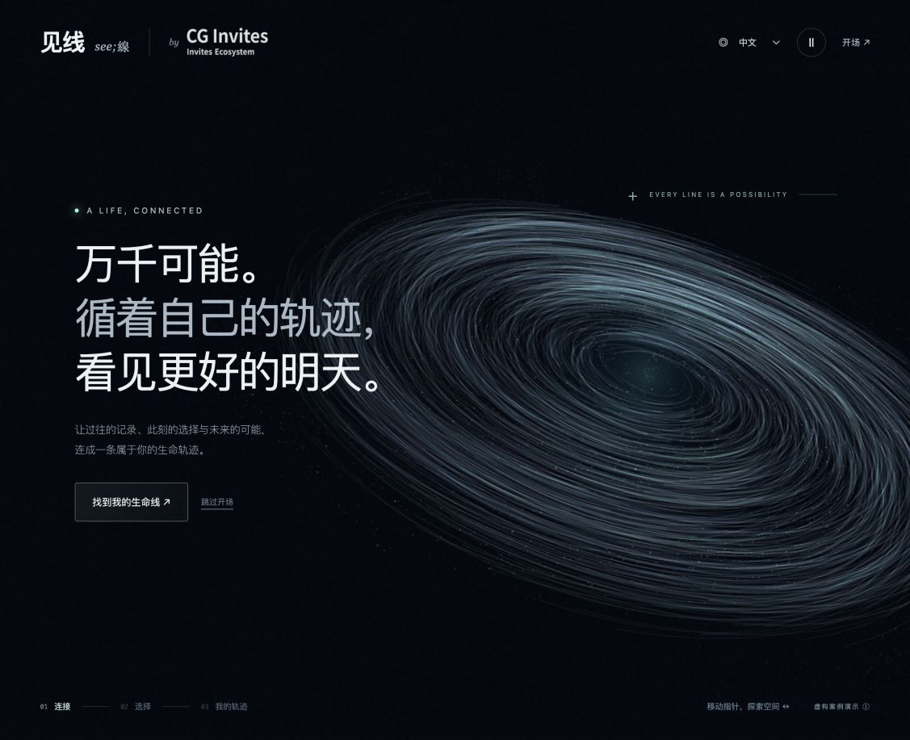
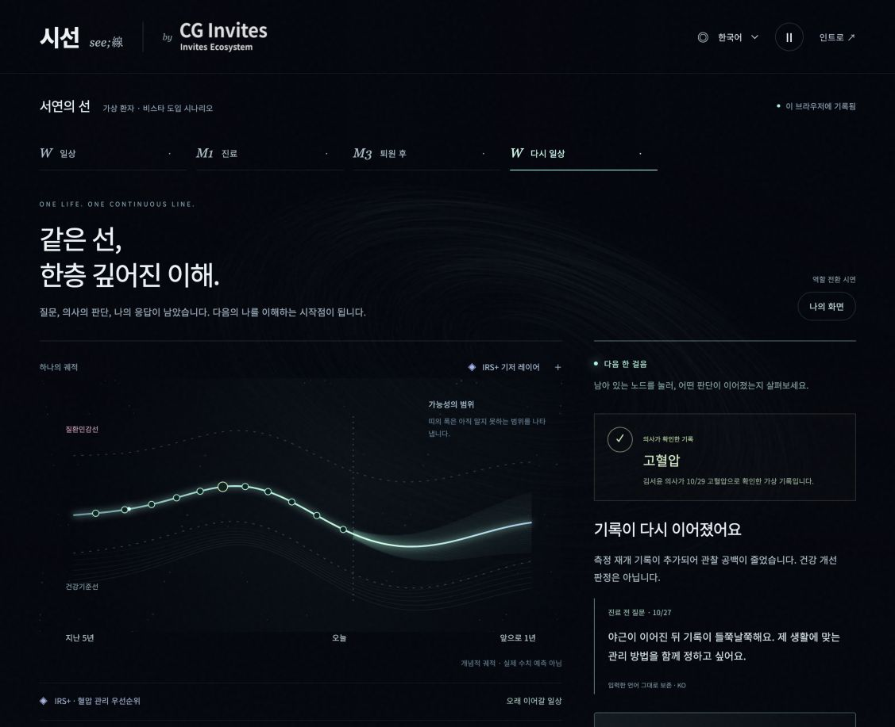

# 시선 · 见线 · SEE;LINE

**삶의 선을 잇고, 더 나은 내일을 보다.**

CG Invites / 인바이츠루프 V5의 3D 인터랙티브 시연. 수많은 선에서 나의 선을 선택하고 **W → M1 → M3 → 다시 W**를 같은 기록으로 이어 간다. 한국어·중국어 간체·영어 지원.



## 내일 시연 / Quick start

- 시연일: **2026-10-28 (한국 시간)**
- 고정 스냅샷: **`demo-2026-10-28`** 태그
- [시연 순서·복구·현장 준비](docs/DEMO-2026-10-28.md)
- [中文 / English 발표 대본과 제품 기준](docs/PRODUCT-AND-DEMO.md)

Node.js 22 이상이 설치되어 있으면:

```sh
git clone https://github.com/jangjumyoeng/siseon.git
cd siseon
npm run dev
```

패키지 설치나 API 키 없이 실행된다. 다음 주소를 연다.

| 언어 | 로컬 주소 | 배포된 시연 |
| --- | --- | --- |
| 한국어 · 시선 | http://127.0.0.1:4173/?lang=ko | [한국어 열기](https://siseon-galaxy-1027.grittyhaven130.chatgpt.site/?lang=ko) |
| 简体中文 · 见线 | http://127.0.0.1:4173/?lang=zh | [中文演示](https://siseon-galaxy-1027.grittyhaven130.chatgpt.site/?lang=zh) |
| English · SEE;LINE | http://127.0.0.1:4173/?lang=en | [English demo](https://siseon-galaxy-1027.grittyhaven130.chatgpt.site/?lang=en) |

macOS는 `run-demo.command`, Windows는 `run-demo.bat`로도 실행할 수 있다. 실행기는 Node를 먼저 사용하고, 없으면 Python 3로 정적 파일을 제공한다. 라이브러리와 로고가 동봉되어 시연 중 CDN을 요구하지 않는다. 지침 원문 링크를 여는 동작에는 인터넷이 필요하다.

GitHub 저장소와 기존 배포 사이트는 비공개다. 다른 계정에는 각 서비스에서 접근 권한이 별도로 필요하다. 중국 현지 네트워크와 실기기 검증은 미실시다. 계정 없이 전달할 때는 소유자가 소스 패키지를 전달해 로컬에서 실행할 수 있다.

## 다른 AI와 이어서 개발

**[AI 인수인계 문서](docs/AI-HANDOFF.md)의 시작 프롬프트를 복사해 사용한다.** 특정 AI 계정·이전 대화·Codex 설치에 의존하지 않는다.

- [AGENTS.md](AGENTS.md): 모든 AI가 읽을 공통 지침
- [CLAUDE.md](CLAUDE.md), [GEMINI.md](GEMINI.md): 공통 지침으로 연결하는 진입 파일
- [개발 안내](docs/DEVELOPMENT.md): 파일 구조, 상태 전이, 테스트, 배포
- [후속 개발 우선순위](docs/ROADMAP.md): 구현된 것과 남은 것
- [시선 전용 스킬](skills/siseon-v5/SKILL.md): 세계관·UX·임상 발화·평가 기준

```sh
npm run verify
```

GitHub Actions도 같은 검증을 실행한다. **자동 배포는 하지 않는다.** 내일 시연용 태그를 보존하고 기능 개발은 새 브랜치에서 진행한다.

## 현재 구현

3D 은하 인트로 / 목표 선택 / IRS+·두 기준선·미래 띠 / 질문 원문 / 의사 확인·진단 보류·정정 / 가상 퇴원 인계 / 측정 공백 / 근거를 확인한 개입 / Yes·No / 후속 관찰 / 재방문·언어 전환·브라우저 저장 복원.



이것은 **가상 사례 브라우저 데모**다. 실제 진단·의료진 인증·EMR·전송·Flutter 앱·병원 설치 시스템은 연결되지 않았다. 미래 띠는 개념적 불확실성 표현이며 임상 위험도나 치료 효과가 아니다. 기능별 6대 지침·3+1 대응, 금지 패턴 점검과 KPI 실증 계획은 [제품 문서](docs/PRODUCT-AND-DEMO.md)에 있다.

회사 로고 권리는 해당 권리자에게 있다. 동봉한 Three.js는 `dist/vendor/THREE-LICENSE.txt`를 따른다. 프로젝트 전체에 오픈소스 라이선스를 부여한 것은 아니다.
